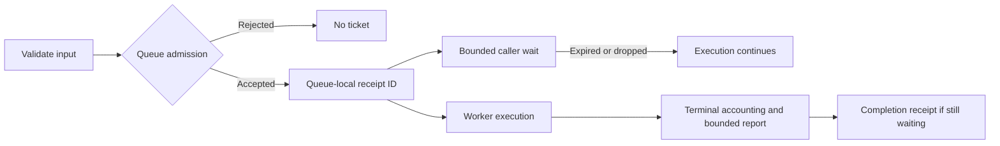

# Plugin author and host API contracts

API baseline: 0.9.0. Native wire contracts and mobile DTOs are unchanged.

## Author implementations and host capabilities

Native EventHook and BenchmarkSink authors implement `PluginEventHook` and
`PluginBenchmarkSink`. Author failures describe outcomes from plugin code;
checked host capabilities report codec, ABI, protocol, and execution errors.

| Role | EventHook | BenchmarkSink |
| --- | --- | --- |
| Native author implementation | `PluginEventHook` → `PipelineEventHookFailure` | `PluginBenchmarkSink` → `BenchmarkSinkFailure` |
| Checked host capability | `PipelineEventHook` → `PipelineEventHookError` | `BenchmarkSink` → `BenchmarkSinkError` |

`PluginBuilder::with_pipeline_event_hook` requires `PluginEventHook`;
`PluginBuilder::with_benchmark_sink` requires `PluginBenchmarkSink`. A checked
host-trait implementation alone cannot be registered for Native export.

## EventHook

```rust
use player_plugin::{
    PipelineEvent, PipelineEventHookFailure, PipelineEventHookOutcome, PluginEventHook,
};

struct Hook;

impl PluginEventHook for Hook {
    fn on_event(
        &self,
        event: &PipelineEvent,
    ) -> Result<PipelineEventHookOutcome, PipelineEventHookFailure> {
        if event.event_name == "example.unsupported" {
            return Err(PipelineEventHookFailure::Rejected("unsupported event".to_owned()));
        }
        Ok(PipelineEventHookOutcome::accepted())
    }
}
```

The failure variants are `InvalidInput`, `Rejected`, and `Failed`. Every message
must contain 1–256 UTF-8 bytes. The export adapter validates this limit without
trimming or changing valid text. Invalid messages or outcomes remain ABI
violations. `Ok` with `accepted: false` remains a successful invocation with a
nonaccepting outcome; it differs from `Err(Rejected(...))`.

Input and output validators return host protocol errors. Export adapters
validate incoming data before invoking author code and validate author output
before returning it. Host codec, ABI, and protocol errors are not author failures
and cannot be returned through an author trait.

## BenchmarkSink

```rust
use player_plugin::{
    BenchmarkEventBatch, BenchmarkSinkFailure, BenchmarkSinkStatus, PluginBenchmarkSink,
};

struct Sink;

impl PluginBenchmarkSink for Sink {
    fn name(&self) -> &str { "example" }

    fn on_event_batch(
        &self,
        batch: &BenchmarkEventBatch,
    ) -> Result<BenchmarkSinkStatus, BenchmarkSinkFailure> {
        Ok(BenchmarkSinkStatus { accepted_events: batch.events.len() as u64 })
    }
}
```

Author failures use `BenchmarkSinkFailure::Failed(message)`. The default
`flush` implementation returns an empty `BenchmarkSinkReport`. An overridden
`flush` returns `Result<BenchmarkSinkReport, BenchmarkSinkFailure>`.

BenchmarkSink author failures have no additional error-message limit.
The Native decoder accepts the compatibility `payloadCodec`,
`abiViolation`, `sinkFailed`, and `protocolViolation` failure payloads. Those
legacy remote tags do not establish local-host provenance.

## Host consumers and wire compatibility

Host integrations invoke `PipelineEventHook` and `BenchmarkSink` and receive
`PipelineEventHookError` and `BenchmarkSinkError`. Explicit `From` conversions
project author failures into the host error representations. A local implementation needed in both roles requires a separate
host adapter; no automatic trait bridge or compatibility alias is provided.

The Native root/table layouts, interface IDs/versions, status meanings, optional
BenchmarkSink flush tail, and JSON `code`/`message` shape remain unchanged:

- EventHook failures retain `invalidInput`, `rejected`, and `failed`.
- BenchmarkSink `Failed` retains `sinkFailed`.
- Valid author failures use `FAILURE`. SDK input errors use `INVALID_ARGUMENT`;
  invalid author output uses `ABI_VIOLATION`.
- Checked Native EventHook decoding continues rejecting forged host-only failure
  tags and invalid messages, and poisons the affected interface.

WASM generated author traits and WIT `plugin-error` remain unchanged. C ABI and
Kotlin, Swift, and Dart public DTOs are unchanged. The Rust APIs described here
require the matching SDK source or release.
These source APIs require matching 0.9.x CLI and SDK packages. The published
0.8.0 SDK does not provide the new author traits or queue contracts.

## WASM host execution and queues

The low-level WASM host exposes typed execution causes and explicit queue receipts.
Transport-neutral `PipelineEventHook` and `BenchmarkSink` return their SDK
errors; those adapters format low-level host causes at that boundary.
Integrations needing typed trap inspection and settlement use the host crate's
sessions and queues directly.

Event and Benchmark queues accept owned input through `submit` and return a
`WasmInvocationTicket`. `submit_and_wait(input, timeout)` combines admission
with one bounded ticket wait. Event `enqueue` reports
`Enqueued { invocation_id }`; Benchmark enqueue reports its `batch_id`.
Event `flush` and `close` return `WasmQueueSettlement`; Benchmark reports carry
`settlement: WasmQueueSettlement` alongside their guest result.

Compilation and instantiation errors contain `WasmErrorCause`. Execution
errors contain `WasmExecutionFailure { kind, cause }`. Queue failures use
`Queue(WasmQueueError)`; caller wait expiry uses
`WaitExpired { operation, invocation_id }`. Local input validation and
guest-declared invalid input are separate `LocalValidation` and
`GuestInvalidInput` variants. A quarantined session exposes its original
cause through `Quarantined { reason }` and `quarantine_reason()`.

### Accepted work, completion, and waiting

`submit` validates the owned event/batch and accepts it into a bounded queue. Its
receipt contains a queue-local monotonic ID, not a global identifier. Benchmark
report `batch_id` equals the ticket's `invocation_id()`. Admission failure returns
no ticket. Benchmark `enqueue` also reserves IDs for dropped batches, so gaps do
not indicate missing accepted work. IDs never wrap; exhaustion returns
`WasmQueueError::IdExhausted`.

```rust
let ticket = queue.submit(event)?;
let invocation_id = ticket.invocation_id();
let report = ticket.wait(timeout)?;
assert_eq!(report.invocation_id, invocation_id);
let outcome = report.result?;
```

The outer wait result means a completion receipt arrived. `report.result` contains
the guest outcome or execution failure. `WaitExpired` bounds only the caller's
wait; it does not cancel accepted work or quarantine the guest. Dropping a ticket
also leaves the invocation running. The eventual same-ID report enters the
bounded report sink. A full sink drops the newest report and increments its loss
counter; successful settlement cannot guarantee that every diagnostic report
remains available. Ticket delivery is independent of report-sink capacity.



### Barriers and final settlement

Event `flush` returns a FIFO worker-time accounting snapshot. Benchmark `flush`
adds the guest's aggregate report. A snapshot may include later accepted work as
pending, but does not include that work's later completions. `settlement()` returns
current cumulative accounting. A completed Benchmark flush whose caller expired
is cached; the next `flush()` retrieves that original barrier report without a
second guest flush. Until completion, another flush returns `FlushPending`.

`WasmQueueSettlement` records accepted/completed/failed invocations, pending work,
result-ticket wait expirations, lifecycle, worker join, and the original quarantine
cause. Invocation counters cover events/batches; guest flush failures do not add
failed invocations. `wait_expirations` covers only expired event/batch ticket waits,
not dropped tickets, flush/close waits, or worker-join waits. Diagnostic-drain loss
counters reset when drained; settlement counters remain cumulative.

`close` rejects new work, drains accepted work, releases the guest session, and
joins the worker within one caller deadline. Successful Event close returns a
settlement; successful Benchmark close returns a report whose `result` may still
contain a guest flush failure. Final success has `Closed`, zero pending work, and
`worker_joined: true`. Close expiry preserves the in-progress state; a later close
can finish joining. Worker/session closure and worker join are distinct facts.
A catastrophic Event worker panic returns its original error from close; current
accounting remains inspectable through `settlement()`. Repeated close is
idempotent for the same settled state. Queue `Drop` requests close and detaches;
it does not wait for or certify settlement.

### Typed errors and provenance

`WasmExecutionFailureKind` separates fuel exhaustion, deadline interruption,
guest traps, guarded host-call failures, and unknown causes. Classification uses
typed downcasts, never formatted-message matching. `failure.cause.error()` exposes
the original `wasmtime::Error`, including `downcast_ref::<wasmtime::Trap>()` and
its source chain. Cloned causes share identity; independently produced errors
with identical text are not equal.

Local input validation, guest-declared invalid input/rejection/failure, worker
panic, execution failure, caller wait expiry, queue state, and protocol violation
remain distinct. A trap, execution-budget failure, worker panic, or invalid guest
output retains its original reason when the session is quarantined. Later calls
return `Quarantined { reason }`. Author-declared failures and caller wait expiry
do not themselves quarantine a healthy guest.

### Validation and outward diagnostics

Queue admission constructs private immutable `CheckedPipelineEvent` and
`CheckedBenchmarkBatch` values. Borrowed SDK adapters validate before cloning;
workers execute those checked values without repeating input validation. Raw
session calls still validate at their boundary. Direct sessions check availability
before raw input; queues validate input before checking admission state.
Guest acknowledgements are checked against the actual batch count, and output
decoders validate complete domain results. Shared attribute decoding preserves
valid whitespace and UTF-8, rejects duplicate keys, and enforces existing byte
and count limits. Separate generated WIT worlds retain their own record types.

The download dispatcher preserves checked host error categories and complete
messages. Android/iOS report JSON calls `PipelineEventHookError::report_projection`
only on the outward copy, keeping the existing error code and a 1–256-byte UTF-8
message. Empty diagnostics use `plugin host error`. This projection does not
validate Native author failures, mutate internal reports, or change public JSON
keys. Native artifact validation remains a separate untrusted boundary.

## Scaffold builds and release gates

The 0.9.x CLI generates the Native author traits documented here and pins the
matching SDK version. During local candidate validation, the generated
`player-plugin` dependency can point to `crates/plugin/player-plugin` in the
matching checkout while retaining its version pin. Hosted consumer validation
uses the generated dependency without a local path. The
[Native SDK README](../../crates/plugin/player-plugin/README.md) contains both
dependency forms.

Release acceptance includes matching CLI/SDK versions and a fresh generated
EventHook and BenchmarkSink project that builds with its unmodified declared
SDK dependency and passes checked-loader conformance. The checkout-backed
external-consumer test does not establish publication or registry compatibility.
