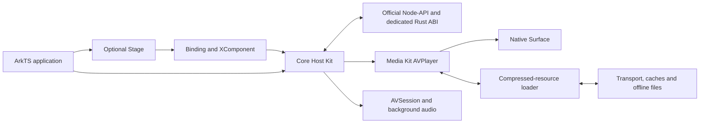

# Vesper Player for HarmonyOS

The HarmonyOS preview provides native Media Kit AVPlayer playback with shared
Rust source, sequence, DASH planning, download and lifecycle semantics. The
candidate version is `0.9.1-harmony.0`, for API 20+ arm64 phones and tablets.
The [artifact workflow](CI.md) builds three HARs, an unsigned example HAP and a
portable example project with local HAR dependencies. The [testing guide](TESTING.md)
covers downloading a build, device signing and diagnostic issue reports.
OHPM publication is deferred; the [registry release process](RELEASING.md) covers
later account/namespace setup and independent registry-consumer verification.

Development evidence uses official API 20 and API 26 arm64 phone simulators.
Physical phone/tablet acceptance, audible output, decoder identity, HDR,
telephony/Bluetooth and power remain unverified. These observations do not block
distribution of the scoped preview. Production signing and registry consumption
require their own distribution receipts. This preview does not expand stable
Android/iOS support.

## Packages and runtime

| Package | Artifact | Responsibility |
| --- | --- | --- |
| `@vesper/player-kit` | `vesper-player-kit.har` | Controller, sources, native bridge, transport, preload/cache, downloads and system session |
| `@vesper/player-kit-arkui` | `vesper-player-kit-arkui.har` | Stable XComponent, binding, disappearance policy and PiP |
| `@vesper/player-kit-arkui-ui` | `vesper-player-kit-arkui-ui.har` | Optional Stage, settings, captions, controls and gestures |

The dependency order is UI → binding → core. Packages declare versioned
dependencies; local overrides select staged HARs. Core includes the Rust
library, official C++ Node-API module and SDK `libc++_shared.so`, with LLVM
runtime notices. Vesper source is Apache-2.0. No FFmpeg or desktop executor
is included in the Harmony artifacts.



AVPlayer executes audio/video demux, decode, clocking and rendering. Decoded
frames never pass through an ArkTS/Rust copy pipeline. External SRT/WebVTT
and limited DASH `wvtt` use a bounded timed-text adapter synchronized to AVPlayer.
AVPlayer selects its system hardware or software decoder. Vesper supplies no
independent software decoder or FFmpeg/AVCodec playback fallback. Missing hardware
catalog matches and an unknown decoder identity are diagnostic results and do not
prevent source activation.

## Sources and activation

```ts
import { VesperPlayerController, VesperSourceSession } from '@vesper/player-kit';

const sources = new VesperSourceSession();
const controller = new VesperPlayerController(context);
controller.attachSurface(surfaceId);
const handle = sources.register({
  kind: 'remote', protocol: 'progressive', label: 'Movie',
  uri: 'https://media.example/movie.mp4', headers: { Authorization: token }
});
try {
  await controller.activate(handle, {
    startPositionMs: 2000, playbackRate: 1.25, playWhenReady: true
  });
} finally {
  handle.close();
}
// Later, after playback finishes:
await controller.dispose();
sources.close();
```

Registration copies descriptors/headers and creates no native player. Separate
registrations never merge access/cache context. Activation resolves after native
readiness, initial seek, rate and play intent. `firstFrame`/`firstFrameMs` report
a later rendering event; activation never establishes audible output.
Each playback instance retains its `MediaSource` until physical AVPlayer
release completes. Its native finalizer owns the resource-loader callback
references; keeping only the loader object is insufficient across garbage
collection. Replacement source preparation also waits for the preceding
native player to release its Surface.

`close()` rejects new acquisition while accepted leases remain valid.
Invalidation/expiry rejects subsequent activation; current playback continues
until stopped, replaced or disposed. Sequences retain separate leases. List
edits and navigation never activate playback; `sequence.activate()` is explicit.
`resolvePending()` forwards generation/request/attempt/revision/expiry fences
to the shared Rust coordinator.

`VesperCancellationToken` cancels activation. Supersession, timeout, disposal and
sequence detach also settle pending operations. Logical cancellation retains
native creation, file and network slots until physical completion. Dispose
closes system/PiP resources before player/loader/files and the source lease.
Failed physical cleanup remains reachable and can be retried.

## Media and API boundary

| Route | Preview contract |
| --- | --- |
| Local progressive | Sandbox file, independent fd per instance |
| HTTP(S) progressive | Exact Range; ignored-Range fallback requires a complete body within 1 MiB |
| HLS | Unencrypted VOD and rolling live; live numeric rate rejected |
| DASH playback | Static single Period without explicit Period start; H.264/AAC SegmentBase, SegmentTemplate and SegmentTimeline. Template presentation offsets are preserved; unrepresented SegmentBase offsets, protected/multi-Period and unsupported text profiles are rejected |
| Dynamic DASH playback | Public activation returns `unsupported`; an internal bounded DASH-to-HLS prototype failed native independent-audio acceptance on API 20/26 |
| DASH preload | Static single Period SegmentBase only; download expansion does not change startup-cache admission |
| DASH download | Finite static single Period SegmentBase or SegmentTemplate, including finite SegmentTimeline and Time addressing; no SegmentList or live recording |
| External captions | UTF-8 SRT/WebVTT; sandbox path or bounded HTTP(S) source |
| Embedded DASH captions | Separate finite unencrypted SegmentBase `wvtt` rendition without edit lists; one fragmented text track, at most 256 KiB and sixteen renditions |
| Filter/ranges | API 26 only; actual native values reported |
| Default-position seek | API 26 VOD; live/DVR activation and live-edge routing remain outside the accepted preview profile |
| HLS fixed video track | API 24+; API 20 uses available bitrate/auto selection |
| DRM, remux, casting, plugins | Outside this preview; recognized protected descriptors/manifests rejected before ordinary cache/download |
| Decoder/HDR | Hardware capability preflight is available; actual AVPlayer decoder identity/enforcement and HDR evidence remain `unknown` |

Remote HLS/DASH uses a bounded in-process loopback HTTP resource server. The
accepted source context, SDK transport and cache supply compressed bytes; Media
Kit still demuxes, decodes and renders them. Each playback instance owns a random
URL capability, up to eight origin listeners and sixteen connections. Native
DASH does not reliably forward MediaSource request headers, so source credentials
stay in the SDK transport and are never used as loopback authentication. Closing
an instance joins physical reads and socket closure before releasing its source
lease. Progressive and local adaptive sources retain their resource-loader path;
offline playback does not acquire an INTERNET permission requirement.

The remote adaptive playback projection selects the preview's MP4/TS AVC/AAC
profile before native rendition selection. It retains supported video ladders,
AAC languages and supported text renditions, and records excluded codec
declarations in bounded diagnostics. I-frame-only trick-play entries are omitted
from the normal playback ladder because API 20 can otherwise select them as
ordinary video variants and fail to prepare. Genuine audio-only variants remain
eligible. Absent or empty codec declarations remain subject to native validation;
unrecognized nonempty declarations are excluded by this playback profile. This
profile does not describe the system's full codec support. Resource references resolve against their original remote
base before receiving a local capability prefix. Parallel DASH BaseURL
alternatives and `xml:base` are explicitly unsupported on this route. Original
source descriptors, cached manifests and download planners retain their original
data; the projection is specific to native playback. This does not add
transcoding or a shared demux/decode engine.

API availability does not guarantee a media combination. `timeRanges()` returns
separate native `loaded` and `seekable` lists and establishes no general LiveDvr
promise. New codec/container/protocol combinations require acceptance evidence.
TLS validation remains the platform default; localhost HTTP tests do not prove
a deployed HTTPS origin's behavior.

| Feature | API 20 | API 24–25 | API 26+ |
| --- | --- | --- | --- |
| VOD play/pause/seek/rate and explicit audio/subtitle selection | Available | Available | Available |
| HLS fixed native video track | Unsupported; bitrate/auto when exposed | Available when catalog permits | Available when catalog permits |
| Advanced track constraints and native loaded/seekable ranges | Unsupported | Unsupported | Available, native values only |
| VOD default-position seek | Unsupported | Unsupported | Available |
| Live numeric seek/rate and resource-loader live-edge seek | Unsupported | Unsupported | Unsupported |

These are implemented API gates, not acceptance on every intervening OS version.
Native rendering evidence must identify its API, source and artifact. Buffering
percentage never fills the timeline's loaded ranges. VOD/unknown/live semantics,
selection requests, native confirmation and observed output remain separate.

`setPlaybackPolicy()` reports each requested parameter as `applied`, `deferred`
or `unsupported`, with an effective value only where known. The native buffer
preferences apply when the next activation initializes a `MediaSource`:

- `buffering.preferredBufferDurationMs` accepts 1,000–20,000 ms in whole seconds,
  mapped without rounding to native `preferredBufferDuration`.
- `buffering.preferredBufferDurationForPlayingMs` accepts 0–20,000 integer ms,
  mapped to the native start/restart threshold in fractional seconds. It cannot
  exceed an explicitly configured preferred buffer duration.
- Providing `buffering: {}` clears both preferences for future activations;
  omitting `buffering` retains the configured preferences.

The active snapshot's `nativeBuffering` identifies its playback epoch, copied
request, submitted native hints and initialization status. Updating policy during
playback does not change that instance or claim an immediate effect. Local
`fdSrc` files report these hints as unsupported. Native initialization accepts
the submitted hints, but exposes no effective-threshold readback or guarantee of
an exact buffered duration. Buffer callbacks and loaded ranges remain separate
observations. Independent `minBufferMs`, `maxBufferMs`, `bufferForPlaybackMs` and
`bufferForPlaybackAfterRebufferMs` remain unsupported; they are not equivalent to
the native preferences. The native fields predate the API 20 preview floor.

`retry.maxAttempts` accepts one to three attempts for future
controller resource requests; it does not configure native reconnection or
independent preload/download transports. Only decoder policy `system` applies;
hardware/software enforcement returns an explicit unsupported result. Invalid
combined requests do not partially update the transport policy.

`VesperBufferingPresets.fastStart()`, `.balanced()` and `.resilient()` return
native duration/start preferences of 2000/500, 5000/1000 and 15000/3000 ms.
These are named hints for the next activation, with no measured performance
guarantee or independent initial/rebuffer thresholds. `refreshDiagnostics()`
samples `getPlaybackInfo()` on API 20 and playback statistics on API 23+ through
the controller's serialized native command queue. It preserves unavailable
sentinels, reports buffer duration in milliseconds and download rates in bits/s,
and fences samples by playback epoch. Native download statistics identify their
loopback, resource-loader or local-file scope; separate upstream counters cover
the controller lifetime. Statistics do not read back effective buffer waterlines.

`queryVideoDecoderCapability({ mimeType, width?, height?, profile?, level? })`
queries the system hardware capability catalog without creating a decoder.
Dimensions and profile/level are paired integer inputs. AVC, HEVC, VP8, VP9 and
AV1 MIME types are accepted. An unavailable result means no matching catalog
entry was returned; it does not identify AVPlayer's actual decoder. Every result
keeps `decoderExecutionEvidence: 'unknown'`.

`diagnosticReport()` and `exportDiagnosticReport()` provide a bounded local feedback
report, including the source build identity, runtime environment, tracks, current
epoch history and observable transport responses. See [Diagnostic feedback](vesper-player-kit/diagnostic-feedback.md)
for capture, privacy and evidence boundaries. The formal example supports local
JSON saving and preset scenarios; it never uploads reports automatically.

### Restricted dynamic DASH prototype

Public dynamic DASH activation is closed and returns `unsupported`. An internal
prototype projects dynamic MPDs into HLS master/media playlists inside one
activation-owned session. Rust reuses the shared Timeline expansion,
template expansion and HLS builders. The native HTTP server forwards complete
fMP4 initialization/media bytes unchanged, including any sidx boxes; Media Kit
AVPlayer continues to own decoding, timing and presentation.

The profile requires one AVC video and one AAC-LC audio representation, original
audio/video clocks aligned within 50 ms, zero presentation offsets, stable
initialization/codec/template identity, and explicit finite continuous Timeline
entries with nonnegative repeat counts. It accepts Number/Time template addressing
through the shared bridge. Each track has 3–256 segments of 0.1–30 seconds, with
an explicit 1–30 second minimum update period. MPDs are limited to 256 KiB and
projection responses to 900 KiB. Multi-Period, DRM, SegmentBase/List, open-ended
repeats, partial segments and wall-clock availability calculations are rejected.

Playlist requests share one MPD refresh. Media sequences cannot move backward or
repoint an overlapping segment. Exact ticks and sequence identities stay in Rust
or decimal strings. Current/previous resource windows and at most sixteen pinned
responses are retained within 1044 mappings; active transfers prevent eviction.
At most two consecutive transient refresh failures may reuse a coherent window,
for less than ten seconds. Source replacement cancels refreshes and joins physical
HTTP work before releasing the bridge and source lease.

Native validation did not accept this profile: API 20 did not request its separate
audio playlist; API 26 loaded that playlist once, then stalled at the initial
audio tail while the video playlist and segment requests continued. A direct
AVPlayer HTTP comparison reproduced the missing audio refresh without the SDK
loopback server. This is evidence about the tested independent fMP4 profile,
not every possible HLS audio format. The internal host-test opt-in is not a public
playback option. No live DVR/rate contract is enabled. On the tested API 26 runtime, direct native HLS
default-position seeking reports 5400102 (not in live seek mode), and seekable
ranges differ from playback-position coordinates; live seeking stays unsupported.

On API 26, `setTrackConstraints()` additionally accepts `maxVideoResolution` and
`minVideoResolution` as positive integer `{ width, height }` pairs, and
`preferredAudioLanguages` / `preferredSubtitleLanguages` as priority lists of up
to eight BCP 47 language tags. Empty language lists remove that preference.
Bitrate and frame-rate constraints retain their existing names. `{}` clears the
native filter. Inputs are copied before queuing; invalid requests never reach
the native player. API 20–25 reject the operation before calling a higher API.
The return value is native filter readback, including zero/unrestricted native
sentinels. `snapshot().trackConstraints` records requested and accepted values
with a playback epoch; replacement activation clears them. Neither readback nor
language order proves an actual rendition switch. Actual dimensions, selected
track language and selection events must be observed for each source. Native
subtitle filters do not select Vesper's external/DASH timed-text adapter; use
`setTrackPreferences()` or explicit subtitle selection for that adapter. The
HLS filter route is exercised separately from unverified DASH/progressive filter
applicability; no general automatic language-reselection claim is made.

`VesperPlaybackRecovery` is a separate opt-in owner. It retries only known
transient network/time-out errors, with one to three activations, a total deadline
of at most 60 seconds and bounded backoff. Its callback must synchronously invoke
the current controller/sequence activation before its first suspension. Each
retry records a new activation/epoch; VOD restores position and playback rate.
Recovery also captures the last explicit video, audio and subtitle choices and
accepted track filters. It reapplies filters before choices, matching the new
catalog by source-local stable subtitle ID or by language, MIME type, dimensions
and bitrate. Old native track IDs never cross epochs. Missing or ambiguous
matches remain observable in `snapshot().restorations`; a successful playback
restart with an unrestored choice reports `recoveredPartial`. Each restoration
shares the recovery cancellation token and remaining deadline. A newer user
selection or filter change cancels restoration before it can override that intent.
Recovery succeeds only after a rendered frame, playing state and target position
are observed. User pause, source replacement and disposal cancel it. Access/
expired-source failures require host refresh; format and unsupported failures
require host action. Resource request retries do not imply playback recovery.
Close the recovery owner when its host policy is disabled.

`setTrackPreferences()` copies up to eight language tags per kind and reports
per-kind results. For each preferred tag, matching tries a case-insensitive
literal match, then an alias comparison key, then a simple language/script/region
fallback without conflicting explicit scripts or regions. Comparison keys cover
`eng/en`, `jpn/ja`, `zho/chi/zh`, `fra/fre/fr`, `deu/ger/de`, `spa/es`, `kor/ko`,
`rus/ru`, `ita/it`, `por/pt` and `ara/ar`; native catalog tags are preserved.
Variants and extensions require an exact comparison key. This is a bounded alias
set, not a complete ISO 639 registry. Audio and `preferred` subtitles issue one explicit selection
after the catalog is ready; later catalog changes do not override an explicit
choice. Subtitle `system` prefers the first available ordinary external
`isDefault` track; otherwise it can choose an external `isForced` track matching
the selected audio language. Without a matching external default, the native
default is retained. Explicit `preferred` or `off` wins over that policy. This is
not native automatic audio/subtitle reselection. Failed/stale
selection retains the preceding effective choice, scoped to its playback epoch.
Paused VOD audio requests resolve after recording one pending choice for the
current epoch. The preceding track remains selected until playback resumes;
`play()` applies the choice and awaits native confirmation within its command
deadline. Choosing the currently selected audio track cancels a pending choice.
Source replacement and disposal discard it. Queuing a choice does not seek or
resume playback.
API 20 SegmentBase audio selection prepares the target language's bounded
initialization/SIDX data before invoking the native switch. Preparation shares
the command deadline and source access context; a preparation failure preserves
the preceding native track.

Every `externalSubtitles` descriptor requires a unique, source-local `id` (1–256
UTF-8 bytes, without control characters) and a display `label`. Optional
`language`, `isDefault` and `isForced` describe its initial selection policy.
The corresponding catalog entry exposes `stableId`, `external` and those roles;
hosts still select it using the current epoch's numeric track ID.
`snapshot().subtitleState` separates catalog loading/empty/ready/partial/failed
from selection system/selecting/selected/off/failed. It includes per-external-ID
load/parse errors and separate catalog/selection error stages. A failed sidecar
remains visible as unavailable and does not independently fail audio/video
playback. Source replacement resets this state. Stage displays external labels,
roles and localized loading/failure feedback.

Numeric caption IDs are epoch-local. Negative IDs select the text adapter; confirmation
means it accepted that request. Native audio/video selection separates request,
confirmation, effective result and failure. Text parsing bounds cue count,
length and overlap. SSA/ASS formatting, arbitrary cue offsets and unrestricted
subtitle MP4 layouts are outside the profile. Native playback projection is
separate from the original MPD used by caption/preload/download planning.
Native HLS buffering can defer the visible result of a bitrate change. In the
remote HTTP route, absent an explicit duration preference, the host submits a
two-second `preferredBufferDuration` hint to avoid prefetching an entire short
VOD before its first rendition change. A larger requested start threshold raises
that default hint to the next whole second to keep the native strategy valid.
This hint does not guarantee an exact buffered duration or an immediate switch.
The subsequent rendition becomes visible after preceding buffered data drains.
A bitrate acknowledgement alone does not establish a rendered
resolution change. Seeking snapshots and events preserve the native completed
position separately from the requested target.

## Cache, downloads and exports

Startup memory and optional `VesperDiskCache` have independent budgets.
`handle.preload()` supports progressive prefix (`downloadOnly`) and static
SegmentBase DASH startup. DASH becomes `playbackReusable` after AVPlayer
consumes cached bytes and reports a first frame.
Resource-loader responses describe the delivered interval with `Content-Range`
and its byte count. An interior read is not reported as whole-resource EOF.

Configure a SourceSession with `VesperDiskCache.open(context, { partition: 'account' })`.
New registration/open scopes never alias old access context. TTL/LRU, hashes and
atomic indexes bound disk data. Mutable manifests and live bypass disk storage.
Failed partial writes roll back; unresolved cleanup blocks admission. Close joins
physical I/O before releasing directory access.

`VesperDownloadManager.open(context)` stores credential-free schema-1 checkpoints
under `filesDir/vesper-downloads`. Finite progressive, unencrypted HLS VOD and
static single-Period DASH SegmentBase and finite SegmentTemplate downloads are supported. Complete files
are verified before `offlineSource(taskId)` returns a local descriptor. Local
adaptive assets have no network fallback. Incomplete restore pauses and requires
`refreshSource()`. `resumeState` distinguishes fresh restart, source refresh and
pending version verification; `reusableBytes` describes checkpointed candidates.
Committed 64 KiB chunks carry SHA-256 hashes. Resume verifies the complete prefix,
truncates crash-era suffixes and requires matching full-locator fingerprint,
strong ETag and total length before issuing Range with If-Range. Changed URLs,
including refreshed signed query parameters, conservatively restart; changed
validators reject reuse. Completed segmented members are verified separately.
URLs/headers never enter the checkpoint; a locator fingerprint is not a reusable
credential. Invalid individual records become removed tombstones and increment
quarantine diagnostics. Invalid whole JSON/schema rejects open.

Template downloads support RepresentationID, Number and finite Timeline Time
tokens, including decimal zero padding up to width 32. Unknown/malformed tokens,
Bandwidth and escaped dollar tokens are rejected before resource probes. Finite
Timeline repeats reuse the shared expander; a negative final repeat needs a finite
MPD duration or a following explicit time. Rewritten local MPDs preserve timescale,
presentation offsets, start numbers and Timeline entries while using local
numbered files. Selected audio adaptations remain separate offline tracks.

Offline playback and alternate-audio switching are separate acceptance gates.
The controlled AVC/AAC fixed-duration Template fixture exposes both downloaded
audio tracks, but switching to its alternate audio timed out on the tested API 26
emulator. Direct AVPlayer playback of the original HTTP MPD, without SDK routing,
also retained the preceding track and emitted no track-change event, both before
and after a seek. This observation does not establish that every Template source
has the same limitation. A download or catalog pass does not imply that alternate
audio switching passed; failed selection remains a failed gate.

Planning admits at most 4096 files and a 900 KiB serialized plan, with a 4 MiB
aggregate Rust plan budget and the existing 1 GiB per-download byte limit.
Length discovery batches up to 128 missing resources with four physical requests,
at most 160 planning rounds and a 60-second discovery deadline. Quotas are checked
before probing a known excessive file count. These limits are independent; 4096
files do not guarantee that every asset fits the byte/plan/deadline budgets.
The separate original/ZIP export limit remains 256 MiB.

`exportAsset(taskId, 'original')` returns an original file or ZIP with segmented
files and `vesper-offline.json`; no remux occurs. The temporary copy survives
manager close/original removal. `save()` opens the document picker's URI without
truncation, requires an empty output, and copies through its file descriptor.
Failed writes restore that output to zero bytes; nonempty user files are preserved.
`share()` loads Share Kit on demand and returns `unsupported` if absent. Its
promise confirms the request to show the system panel, not recipient completion
or panel dismissal. A shared URI retains a ten-minute lease. `release()` removes
an unleased artifact.
`cleanupTemporary(context)` and manager open/export recover expired outputs from
earlier processes. Process exit promises neither continued downloads nor
indefinite shared access.

All formats share a 256 MiB final-output limit, including ZIP metadata. Exports
stream in 64 KiB buffers with SHA-256 verification and ZIP CRC32, allow two
preparations/eight temporary assets and serialize admission against a 512 MiB
directory reservation budget. `exportEligibility` explains availability before
opening Save/Share. Preparation and copy options accept cancellation/timeouts;
physical I/O ownership survives logical cancellation. Save cancellation is
cooperative between chunks; the system picker remains controlled by the user.

## System, UI and diagnostics

`VesperSystemSession.create()` publishes metadata/state, system commands and
optional `AUDIO_PLAYBACK` background tasks. The host declares INTERNET for remote
media, KEEP_BACKGROUND_RUNNING and ability `audioPlayback` for background audio.
Packages never add application permissions automatically.

`updateMetadata(identity, { title, artist?, artworkUri? })` publishes current
media information; capture `sessionId`, `sourceId` and `playbackEpoch` before any
asynchronous host lookup. Stale identities and updates after close are rejected.
Calling it without metadata clears the override and restores the configured
title. Source/controller changes clear old overrides, and omitted artist/artwork
values clear their preceding values. AVSession owns artwork loading; publication
acknowledgment does not prove that a remote image has rendered on a system card.
`setControls()` and the optional configuration `controls` enable play, pause,
stop, seek and speed separately; seek/speed are additionally limited to VOD.
The snapshot exposes `metadataState`, `metadataSourceId` and `supportedControls`.

One selected controller publishes per ability key. Interruption resume checks
epoch and latest user intent; a user pause cancels auto-resume. System mute/duck
is separate from user volume. Simulator service roundtrips and host doubles do
not establish telephony, Bluetooth or lock-screen endurance.

The [binding guide](vesper-player-kit-arkui/README.md) covers disappearance/PiP;
the [Stage guide](vesper-player-kit-arkui-ui/README.md) covers controls, gestures
and host brightness. The [example](../../examples/harmony-arkui-host/README.md)
consumes HARs and integrates native windows.

Snapshots/events include source/activation/epoch, raw native error code, first
frame, track result, cache/loader bytes and retained resources. Error messages
survive JSON copying. Overflow increments `droppedEvents`; the current snapshot
retains failure state. Headers/signed URLs are absent from ordinary diagnostics
and checkpoints. Audio output, decoder and HDR remain `unknown` without evidence.
The native HTTP inventory separates rejected clients, transfer failures, raw
socket-close results and excluded codecs, without exposing capability URLs or
source access data. A recoverable HTTP transfer failure remains diagnostic while
Media Kit retries; an AVPlayer failure still publishes a playback error. Invalid
input, access failures and unsupported manifests fail explicitly.
Buffering callbacks report active buffering, native percentage and cached
duration separately from playback state. Unknown buffering types retain their
raw type/value. Track metadata includes available width/height/bitrate and a
selection capability/reason used to disable unsupported Stage actions.

## Build and verification

Command Line Tools 26.0.0 Release, repository Rust toolchain, OHOS std and
cbindgen are required on the verified Apple Silicon macOS host. No persistent
PATH change is required.

```sh
export VESPER_HARMONY_COMMAND_LINE_TOOLS=/path/to/command-line-tools
./scripts/vesper harmony doctor
./scripts/vesper harmony kit-host-contracts
./scripts/vesper harmony kit-har --offline
./scripts/vesper harmony kit-consumer --har target/harmony-kit/dist/vesper-player-kit.har
./scripts/vesper harmony kit-consumer --har target/harmony-kit/dist/vesper-player-kit.har --no-internet
./scripts/vesper harmony kit-consumer --har target/harmony-kit/dist/vesper-player-kit.har --ui
./scripts/vesper harmony kit-consumer --har target/harmony-kit/dist/vesper-player-kit.har --example
./scripts/vesper harmony kit-verify --hap target/harmony-kit/dist/vesper-harmony-ui-consumer-unsigned.hap
```

`--offline` controls Cargo resolution. OHPM/Hvigor use bundled tools and local
HAR overrides. Each fresh retained consumer uses Release optimization and copied
HARs, without rebuilding Rust/library sources. Native HAR/HAP bytes must match.
The runtime floor is packed API `60000020`, target `260000026`. Hvigor can warn
about the major-zero/prerelease version; the version remains a preview.

Outputs are in `target/harmony-kit/dist`, debug information in
`target/harmony-kit/symbols`, and retained logs in `target/harmony-kit`.
`freeze-candidate.py` binds working source, lock/toolchain, media and artifacts.
Build-input fingerprints exclude generated outputs and the non-build
`.codeartsdoer` / `.merkle-snapshot.json` editor state. Editor preservation uses
a separate inventory. Source, configuration, resources, artifacts and media
remain strict inputs; older candidate fingerprints are never reinterpreted or
rewritten when this inventory changes.
`final-acceptance.py` checks that identity around the API 20/26 matrix, real
force-stop and no-INTERNET offline restore, Stage/PiP and a 100-cycle batch.
Reference simulator observations do not satisfy physical performance/long-play
gates. CI separates Ubuntu Rust/Python contracts and hosted macOS artifact builds;
artifact jobs freeze build-only candidates and do not run simulators. Remote
execution requires its own receipt. All active consumers use the formal
Host Kit packages. The core fixture owns its application skeleton and tests
Worker environment teardown by recovering all 64 native source-session slots.
Host checks also run `scripts/harmony/tests` against the formal artifact verifiers,
including changed/missing native bytes, API floors, debug metadata and offline permissions.
Controlled media fixtures live under `target/harmony-kit/media`.
